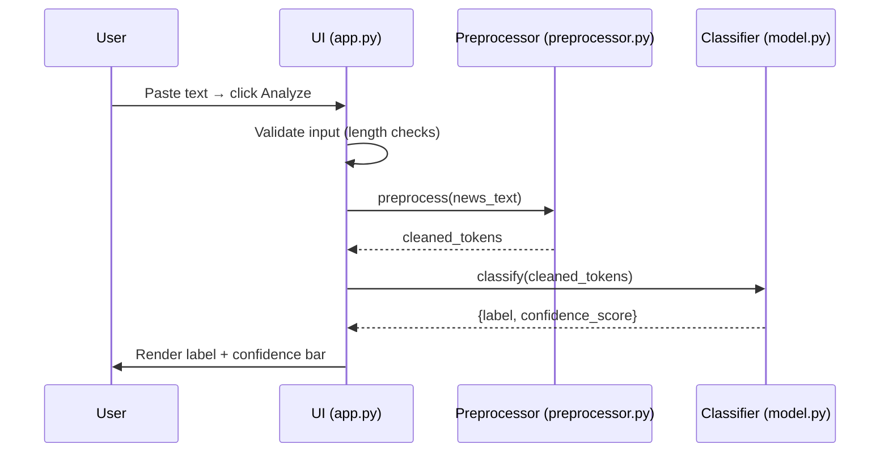
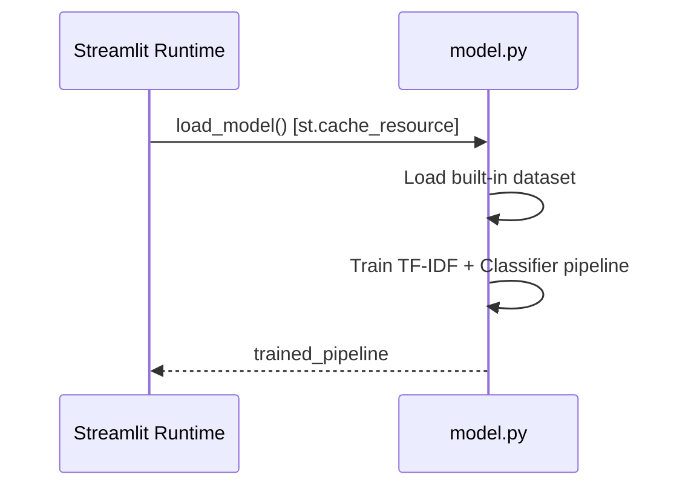

# Design Document

## Overview

The Indonesian News Hoax Detector is a single-page Streamlit web application that classifies Indonesian-language news text as either "FAKTA" (factual) or "HOAX". The user pastes raw news text into a text area, clicks "Analyze", and the app returns a label and a confidence score with visual feedback.

The system is a self-contained Python prototype. It bundles a small labeled dataset, trains a TF-IDF + Naive Bayes (or Logistic Regression) classifier at startup, and caches the trained model for the session. All NLP preprocessing is performed by the [PySastrawi](https://github.com/har07/PySastrawi) library for Indonesian-specific stemming and stopword removal.

Key design decisions:
- **Train-at-startup** keeps the prototype dependency-free from external model files while satisfying the session-caching requirement.
- **`@st.cache_resource`** caches the trained pipeline so it is built once per server process and reused across reruns, avoiding repeated training on every user interaction.
- **`st.session_state`** tracks UI state (input text, result, error messages) so the Reset button can clear everything without a full page refresh.
- **Modular code structure** (preprocessing, model, UI layers) makes each layer independently testable.

---

## Architecture

The application follows a three-layer architecture inside a single `app.py` entry point, supported by two helper modules:

```
revou-pertama/
├── app.py                  # Streamlit entry point, UI layer
├── preprocessor.py         # Text preprocessing pipeline
├── model.py                # Dataset, training, and classification logic
├── requirements.txt        # Pinned Python dependencies
└── README.md               # Setup and launch instructions
```

### Request Flow



### Startup Flow



---

## Components and Interfaces

### 1. `preprocessor.py` — Text Preprocessing Module

Responsible for all NLP cleaning steps. Exposes a single public function.

```python
def preprocess(text: str) -> str:
    """
    Apply the full preprocessing pipeline to raw Indonesian news text.

    Steps (in order):
      1. Lowercase conversion
      2. URL, punctuation, number, and non-alpha-space character removal;
         collapse multiple spaces; strip leading/trailing whitespace
      3. Indonesian stopword removal (PySastrawi StopWordRemoverFactory)
      4. Indonesian stemming (PySastrawi StemmerFactory)

    Args:
        text: Raw Indonesian news text (non-empty).

    Returns:
        Preprocessed string (may be empty if all tokens are removed).

    Raises:
        ValueError: if text is None.
    """
```

Internal helpers (not part of the public API):
- `_lowercase(text: str) -> str`
- `_remove_noise(text: str) -> str`
- `_remove_stopwords(text: str) -> str`  — uses `StopWordRemoverFactory`
- `_stem(text: str) -> str`  — uses `StemmerFactory`

PySastrawi usage pattern ([source](https://github.com/har07/PySastrawi)):
```python
from Sastrawi.Stemmer.StemmerFactory import StemmerFactory
from Sastrawi.StopWordRemover.StopWordRemoverFactory import StopWordRemoverFactory

factory = StemmerFactory()
stemmer = factory.create_stemmer()         # stemmer.stem(word)

sw_factory = StopWordRemoverFactory()
remover = sw_factory.create_stop_word_remover()  # remover.remove(text)
```

### 2. `model.py` — Dataset, Training, and Classification Module

Holds the built-in dataset and exposes two public functions.

```python
DATASET: list[dict] = [...]
# Each entry: {"text": str, "label": str}  where label ∈ {"FAKTA", "HOAX"}
# Minimum 20 entries, 40–60% each class

@st.cache_resource
def load_model() -> tuple[Pipeline, float]:
    """
    Train the TF-IDF + classifier pipeline on DATASET and return it.

    Uses at least a 70/30 train-test split.
    Cached by Streamlit so training runs only once per server process.

    Returns:
        (pipeline, test_accuracy): trained sklearn Pipeline and its accuracy score.

    Raises:
        RuntimeError: if training fails for any reason.
    """

def classify(pipeline: Pipeline, preprocessed_text: str) -> dict:
    """
    Run classification on preprocessed text.

    Args:
        pipeline: Trained sklearn Pipeline from load_model().
        preprocessed_text: Non-empty preprocessed text string.

    Returns:
        {"label": str, "confidence": float}
        where label ∈ {"FAKTA", "HOAX"} and confidence ∈ [0.0, 100.0].

    Raises:
        ValueError: if preprocessed_text is empty or blank.
    """
```

The `Pipeline` uses scikit-learn's `sklearn.pipeline.Pipeline`:
```
Pipeline([
    ("tfidf", TfidfVectorizer()),
    ("clf",   MultinomialNB())   # or LogisticRegression
])
```

### 3. `app.py` — UI Layer (Streamlit)

Orchestrates the UI. Uses `st.session_state` to track:

| Key | Type | Description |
|---|---|---|
| `result` | `dict \| None` | Last classification result |
| `error` | `str \| None` | Last error message to display |
| `input_key` | `int` | Incremented on Reset to force widget re-render |

Key UI sections:
1. **Header** — title + ≤280-char description
2. **Text input** — `st.text_area`, max 10 000 chars shown via `help` text
3. **Analyze button** — triggers validation → preprocessing → classification
4. **Loading indicator** — `st.spinner` wraps the classification call
5. **Results panel** — label (colored), confidence score, progress bar, low-confidence notice
6. **Reset button** — clears `st.session_state` keys and increments `input_key`

---

## Data Models

### Dataset Entry

```python
@dataclass
class DatasetEntry:
    text: str    # Raw Indonesian news text
    label: str   # "FAKTA" or "HOAX"
```

### Classification Result

```python
@dataclass
class ClassificationResult:
    label: str           # "FAKTA" or "HOAX"
    confidence: float    # 0.00 – 100.00 (rounded to 2 decimal places)
```

### Session State Schema

```python
class AppState(TypedDict):
    result: ClassificationResult | None
    error: str | None
    input_key: int  # incremented on Reset to re-render text_area
```

### Preprocessing Pipeline Stages

```
raw_text
  └─[lowercase]──────────────────────────────────► lowercased_text
  └─[remove noise + collapse whitespace]──────────► cleaned_text
  └─[remove Indonesian stopwords (PySastrawi)]────► filtered_text
  └─[stem tokens (PySastrawi)]────────────────────► preprocessed_text
```

### Classifier Pipeline

```
preprocessed_text
  └─[TfidfVectorizer]──► sparse feature matrix
  └─[MultinomialNB / LogisticRegression]──► (label, probability_array)
  └─[confidence = max(probability_array) * 100]──► ClassificationResult
```

---

## Correctness Properties

*A property is a characteristic or behavior that should hold true across all valid executions of a system — essentially, a formal statement about what the system should do. Properties serve as the bridge between human-readable specifications and machine-verifiable correctness guarantees.*

### Property 1: Input validation rejects short and empty inputs

*For any* input string whose stripped length is fewer than 10 characters (including the empty string), the UI validation layer SHALL NOT invoke preprocessing or classification and SHALL produce an error message.

**Validates: Requirements 1.3, 1.4**

### Property 2: Input validation rejects over-length inputs

*For any* input string exceeding 10 000 characters, the UI validation layer SHALL NOT invoke preprocessing or classification and SHALL produce an error message.

**Validates: Requirements 1.5**

### Property 3: Lowercase invariant

*For any* input text, the output of `preprocess()` SHALL contain no uppercase characters.

**Validates: Requirements 2.1**

### Property 4: Preprocessing removes all noise characters

*For any* input string, the output of `preprocess()` SHALL contain no URLs, digits, punctuation marks, or non-alphabetic non-space characters, and SHALL have no leading or trailing whitespace and no consecutive spaces.

**Validates: Requirements 2.2**

### Property 5: Stopword removal is idempotent

*For any* text string, applying stopword removal twice SHALL produce the same result as applying it once — i.e., `remove_stopwords(remove_stopwords(t)) == remove_stopwords(t)`.

**Validates: Requirements 2.3**

### Property 6: Stemming is idempotent

*For any* lowercase alphabetic string, applying stemming twice SHALL produce the same result as applying it once — i.e., `stem(stem(t)) == stem(t)`.

**Validates: Requirements 2.4**

### Property 7: Classifier always returns a valid label and bounded confidence

*For any* non-empty preprocessed text passed to `classify()`, the returned label SHALL be exactly "FAKTA" or "HOAX" and the confidence SHALL be a float in the range [0.00, 100.00].

**Validates: Requirements 3.4**

### Property 8: Confidence display renders correctly for any confidence value

*For any* confidence value in [0.0, 100.0], the UI SHALL display it as a whole-number percentage and render a progress bar whose fill value equals `confidence / 100`, such that the visual bar is proportional to the score.

**Validates: Requirements 4.3, 4.4**

### Property 9: Low-confidence notice appears if and only if confidence is below threshold

*For any* confidence value, the low-confidence notice SHALL be displayed if and only if the confidence is strictly less than 60.0.

**Validates: Requirements 4.5**

### Property 10: Reset returns the app to its initial state for any result state

*For any* UI state in which a classification result is displayed, clicking Reset SHALL clear the text input, remove the result, and return all session state keys to their initial values.

**Validates: Requirements 5.4**

---

## Error Handling

| Error Condition | Where Handled | User-Facing Behavior |
|---|---|---|
| Empty text input | `app.py` validation | Error message: "Masukkan teks berita sebelum melanjutkan." |
| Input < 10 chars | `app.py` validation | Error message: "Teks terlalu pendek untuk dianalisis (minimal 10 karakter)." |
| Input > 10 000 chars | `app.py` validation | Error message: "Teks melebihi batas 10.000 karakter." Classification is blocked. |
| Empty string after preprocessing | `app.py` post-preprocess check | Error message: "Teks tidak mengandung konten yang dapat dianalisis." |
| `classify()` receives empty text | `model.py` | Raises `ValueError`; caught in `app.py` and shown as error message |
| Model training failure at startup | `model.py` `load_model()` | Raises `RuntimeError`; caught in `app.py` with fatal message; app halts further UI rendering |
| Invalid label returned by classifier | `app.py` post-classify check | Error message: "Hasil klasifikasi tidak valid, analisis tidak dapat diselesaikan." |
| Low confidence (< 60%) | `app.py` result rendering | Notice: "Tingkat keyakinan rendah — hasil mungkin kurang akurat." |

All validation errors clear when the user modifies input to meet requirements (Requirement 1.6), implemented by re-evaluating validation state on each Streamlit rerun.

---

## Testing Strategy

### Unit Tests (`pytest`)

Unit tests cover specific examples, edge cases, and error conditions for the preprocessing and model modules independently of the Streamlit UI.

**`preprocessor.py` unit tests:**
- Lowercase conversion: uppercase input → all-lowercase output
- URL removal: text containing `http://` and `https://` URLs → URLs absent from output
- Punctuation removal: text with commas, periods, exclamation marks → punctuation absent
- Number removal: text with digits → digits absent
- Whitespace normalization: multiple consecutive spaces → single space, no leading/trailing whitespace
- Stopword removal: text containing known Indonesian stopwords (e.g., "yang", "dan", "di") → stopwords absent
- Stemming: known inflected words (e.g., "berlari" → "lari") are reduced correctly
- Pipeline order: each step is applied in the correct sequence
- Empty-after-preprocessing: input composed only of stopwords and numbers → empty string returned

**`model.py` unit tests:**
- Dataset balance: FAKTA/HOAX proportions are each between 40% and 60%
- Dataset size: at least 20 entries
- `load_model()` returns a fitted sklearn Pipeline
- `classify()` with valid text returns label ∈ {"FAKTA", "HOAX"} and confidence ∈ [0.0, 100.0]
- `classify()` with empty string raises `ValueError`
- `classify()` with whitespace-only string raises `ValueError`

**`app.py` validation logic unit tests** (tested by calling the validation function directly, not via Streamlit):
- Empty input → error, no classify call
- Input with 9 characters → error, no classify call
- Input with 10 characters → passes validation
- Input with 10 000 characters → passes validation
- Input with 10 001 characters → error, no classify call
- Low confidence result (< 60%) → low-confidence notice is set

### Property-Based Tests (`pytest` + `hypothesis`)

Property-based tests use the [Hypothesis](https://hypothesis.readthedocs.io/) library to verify universal properties across generated inputs. Each test runs a minimum of 100 iterations.

```
# Tag format: Feature: indonesian-news-hoax-detector, Property {N}: {property_text}
```

**Property 1: Input validation rejects short and empty inputs**
Generate strings with `len(text.strip()) < 10`. Assert that the validation function returns an error and does not call classify.
`# Feature: indonesian-news-hoax-detector, Property 1: Input validation rejects short and empty inputs`

**Property 2: Input validation rejects over-length inputs**
Generate strings with `len(text) > 10_000`. Assert that the validation function returns an error and does not call classify.
`# Feature: indonesian-news-hoax-detector, Property 2: Input validation rejects over-length inputs`

**Property 3: Lowercase invariant**
Generate arbitrary Unicode strings. Assert that `preprocess(text)` contains no uppercase characters.
`# Feature: indonesian-news-hoax-detector, Property 3: Lowercase invariant`

**Property 4: Preprocessing removes all noise characters**
Generate strings containing URLs, digits, and punctuation. Assert that `preprocess(text)` contains none of those character classes, has no leading/trailing whitespace, and has no consecutive spaces.
`# Feature: indonesian-news-hoax-detector, Property 4: Preprocessing removes all noise characters`

**Property 5: Stopword removal is idempotent**
Generate arbitrary Indonesian-like text strings. Assert that applying `_remove_stopwords` twice equals applying it once.
`# Feature: indonesian-news-hoax-detector, Property 5: Stopword removal is idempotent`

**Property 6: Stemming is idempotent**
Generate arbitrary lowercase alphabetic strings. Assert that applying `_stem` twice equals applying it once.
`# Feature: indonesian-news-hoax-detector, Property 6: Stemming is idempotent`

**Property 7: Classifier always returns a valid label and bounded confidence**
Generate non-empty preprocessed text strings. Assert that `classify(pipeline, text)` returns a label in {"FAKTA", "HOAX"} and a confidence in [0.00, 100.00].
`# Feature: indonesian-news-hoax-detector, Property 7: Classifier always returns a valid label and bounded confidence`

**Property 8: Confidence display renders correctly for any confidence value**
Generate float values in [0.0, 100.0]. Assert that the rendered display shows the rounded integer value and the progress bar value equals `confidence / 100`.
`# Feature: indonesian-news-hoax-detector, Property 8: Confidence display renders correctly for any confidence value`

**Property 9: Low-confidence notice appears if and only if confidence is below threshold**
Generate arbitrary float confidence values. Assert that the notice is shown iff `confidence < 60.0`.
`# Feature: indonesian-news-hoax-detector, Property 9: Low-confidence notice appears if and only if confidence is below threshold`

**Property 10: Reset returns the app to its initial state for any result state**
Generate arbitrary classification result states. Assert that after Reset, all session state keys are at their initial values (result=None, error=None, input cleared).
`# Feature: indonesian-news-hoax-detector, Property 10: Reset returns the app to its initial state for any result state`

### Integration Tests

- Full pipeline test: raw Indonesian text → `preprocess()` → `classify()` → valid `ClassificationResult`
- Startup test: `load_model()` completes without error and returns a fitted pipeline with a non-zero test accuracy
- End-to-end smoke test: run `streamlit run app.py --server.headless true` and confirm the process starts without a startup error (CI only)
